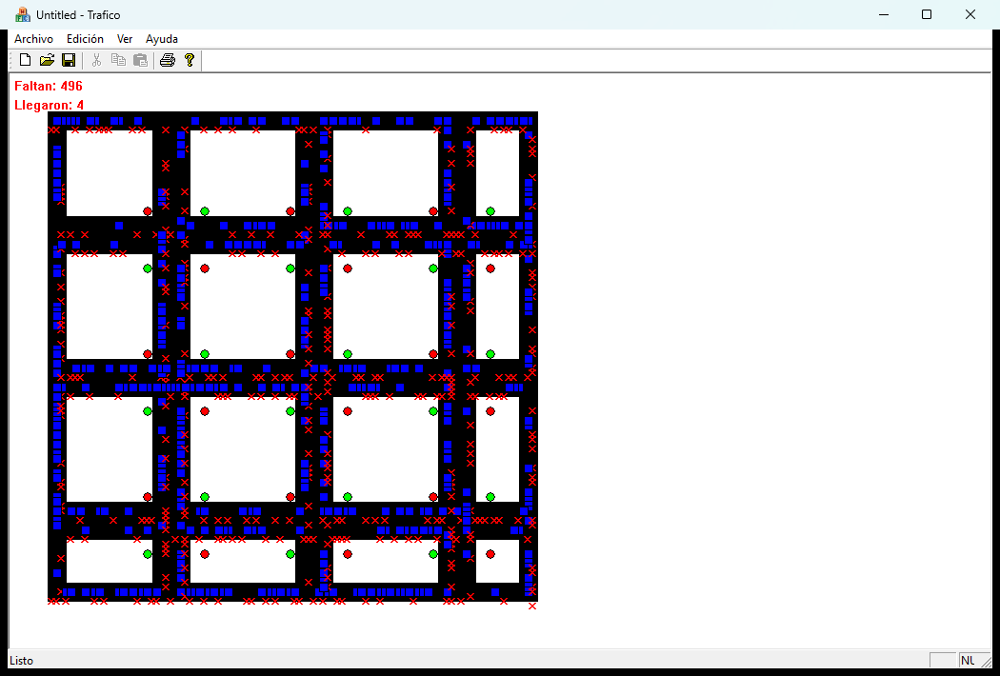
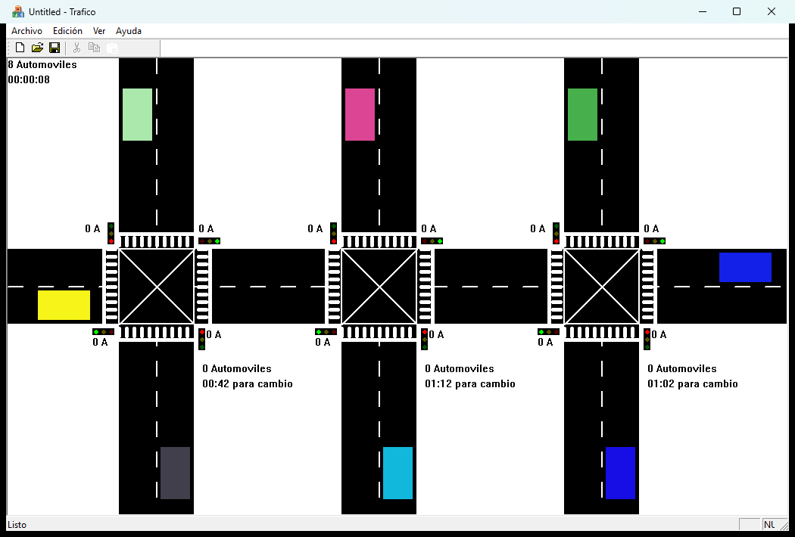
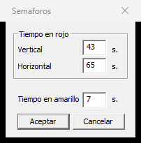

# Trafico
[English](#english) · [Español](#español)

## English


> [!WARNING]
> **Status: Legacy.** Archived Win32 exercise that runs with simulated cars and roads.

Legacy Windows simulation of cars, road intersections and traffic light timing

### Overview

Trafico helps a learner see how the rules at an intersection affect the cars approaching it. The scene draws roads, vehicles and signal colours on screen. The June release draws one cross street and three separate junctions. The software adds cars at the road entrances and shows vehicle counts, a simulated clock and the time left before each light changes.

### Features

- Shows cars moving through the simulated road network.
- Draws green and red signals and updates counters as the simulation advances.
- Adjusts the red times independently for the vertical and horizontal roads at a selected junction.
- Shows a countdown to the next signal change and the simulated time.

### Requirements

- Windows desktop, Visual Studio Community 2026 18.10.3, MSVC v145, MFC x86 and Windows SDK 10.0.26100.0. Build for Win32. The simulation uses the Windows graphics APIs.

### Getting started

In Developer PowerShell for Visual Studio, run the following from the repository root.

```powershell
MSBuild Trafico.sln /m:2 /nr:false /t:Rebuild /p:Configuration=Release /p:Platform=Win32
.\bin\Release\Trafico.exe
```

### Usage

Launch `Trafico.exe`. Double-click the centre of a visible junction to open **Semaforos**. Set the red duration for each direction and the yellow duration. Click **Aceptar** and reopen the same junction to check the values.

If a junction is outside the visible area, enlarge the window and choose **Archivo → Nuevo**. This starts a fresh simulation using the new window size, with new vehicle counters.

### Project structure

`TraficoView.cpp` draws the scene and advances the simulation. `Carretera` describes a road and `Semaforo` implements a signal. The June source under `Trafico/` also contains the junction classes and the settings dialog.

### Support

Describe the commit, toolchain, window size and junction when reporting a problem. Use a copy of the recovered project for the steps to reproduce it.

### Contributing

Build the Win32 solution and compare vehicle motion and signal settings before making changes to the model. Keep the original archive dates and credits with historical revisions.

### History

The latest source entries in `Traficov1.rar` are dated 19 May 2006. The timestamp uses that date at 12:00 UTC because the archive does not record a Git commit time.

`Trafico.rar` holds the update dated 1 June 2006. It changes the route model, draws three junctions and adds a settings dialog for each traffic light. The reconstruction in 2026 retains its original solution under `Trafico.legacy.sln` and the original `.vcproj` beside the converted project.

The first documentation pass explains how to restart the simulation after resizing so the layout fits the window.

### Verification

**19 November 2026.** Windows 11 Pro build 26300, Visual Studio Community 2026 18.10.3, MSBuild 18.10.1.42706, MSVC 14.51.36231 and Windows SDK 10.0.26100.0. The commands above built and ran each of the four revisions. The May copy moved cars across the grid and showed the arrival counters. In the June copies, **Archivo → Nuevo** rebuilt the three-junction layout after resizing. The dialog kept red times of 43 and 65 simulated seconds and a yellow time of 7 when reopened. All processes closed normally.







### License

The project’s own code and documentation use the [MIT license](LICENSE).

---

## Español


> [!WARNING]
> **Estado: Legado.** Ejercicio Win32 archivado con autos y calles simulados.

Legado de Windows para simular autos, cruces y tiempos de semáforos

### Descripción general

Trafico permite observar cómo las reglas de un cruce afectan a los autos que se acercan. Dibuja las calles, los vehículos y el color de cada semáforo en la pantalla. La versión de junio dibuja una calle transversal y tres cruces. El programa agrega autos en los accesos y muestra la cantidad de vehículos, un reloj simulado y el tiempo que falta para el siguiente cambio de semáforo.

### Funciones

- Muestra autos que avanzan por una red de calles ficticia.
- Dibuja las señales en verde y rojo y actualiza los contadores mientras avanza.
- Ajusta por separado el rojo de la calle vertical y el de la horizontal en un cruce.
- Muestra la cuenta regresiva para el cambio de señal y el tiempo simulado.

### Requisitos

- Windows de escritorio, Visual Studio Community 2026 18.10.3, MSVC v145, MFC x86 y el SDK de Windows 10.0.26100.0. Compila para Win32. La simulación usa las funciones gráficas de Windows.

### Cómo empezar

En Developer PowerShell para Visual Studio, ejecuta lo siguiente desde la raíz del repositorio.

```powershell
MSBuild Trafico.sln /m:2 /nr:false /t:Rebuild /p:Configuration=Release /p:Platform=Win32
.\bin\Release\Trafico.exe
```

### Uso

Abre `Trafico.exe`. Haz doble clic en el centro de un cruce visible para abrir **Semaforos**. Indica la duración del rojo en cada dirección y la del amarillo. Pulsa **Aceptar** y vuelve a abrir el mismo cruce para comprobar los valores.

Si un cruce queda fuera del área visible, agranda la ventana y elige **Archivo → Nuevo**. Esto inicia una simulación con el tamaño de ventana nuevo y reinicia los contadores de autos.

### Estructura del proyecto

`TraficoView.cpp` dibuja la escena y hace avanzar la simulación. `Carretera` describe una calle y `Semaforo` implementa una señal. La fuente de junio, en `Trafico/`, incorpora las clases de los cruces y el diálogo de ajustes.

### Soporte

Indica el commit, las herramientas, el tamaño de la ventana y el cruce cuando reportes un problema. Usa una copia del proyecto recuperado para reproducirlo.

### Contribuir

Compila la solución Win32 y compara el movimiento de los autos y los ajustes de los semáforos antes de cambiar el modelo. Conserva las fechas de respaldo y las atribuciones de las revisiones históricas.

### Historial

Los archivos fuente más recientes de `Traficov1.rar` son del 19 de mayo de 2006. Se usó esa fecha a las 12:00 UTC porque el respaldo no conserva una hora de commit en Git.

`Trafico.rar` conserva la edición fechada el 1 de junio de 2006. Cambia el modelo de rutas, dibuja tres cruces y permite configurar cada semáforo. La reconstrucción de 2026 mantiene su solución original como `Trafico.legacy.sln` y el `.vcproj` al lado del proyecto convertido.

La primera revisión de documentación explica cómo volver a iniciar la simulación tras cambiar el tamaño para que el dibujo quepa en la ventana.

### Verificación

**19 de noviembre de 2026.** Windows 11 Pro compilación 26300, Visual Studio Community 2026 18.10.3, MSBuild 18.10.1.42706, MSVC 14.51.36231 y SDK de Windows 10.0.26100.0. Los comandos anteriores compilaron y ejecutaron los cuatro commits. La copia de mayo movió autos en la cuadrícula y mostró los contadores de llegadas. En las copias de junio, **Archivo → Nuevo** volvió a crear los tres cruces después de ajustar la ventana. Al reabrir el diálogo se conservaron 43 y 65 segundos simulados de rojo y 7 de amarillo. Todos los procesos cerraron normalmente.


### Licencia

El código y la documentación propios se rigen por la [licencia MIT](LICENSE).
